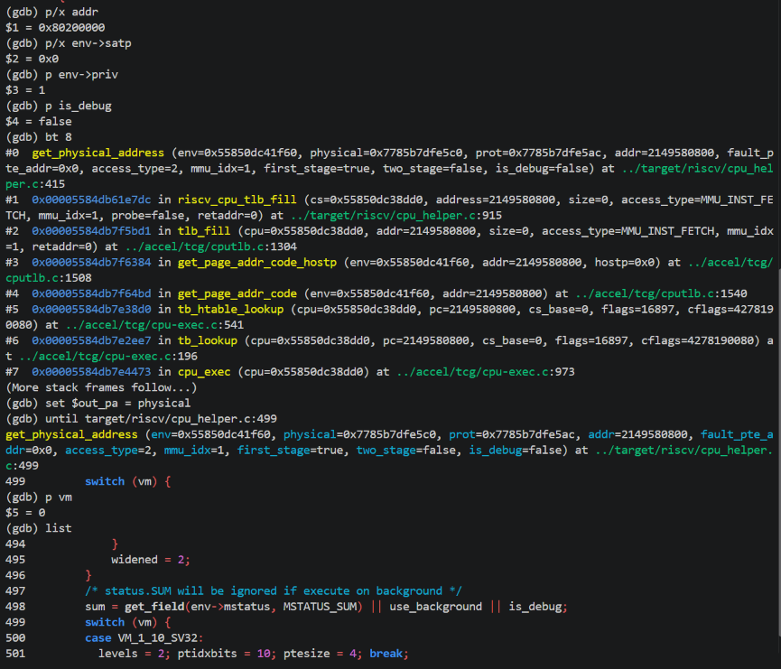
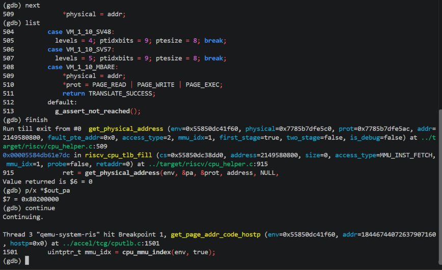
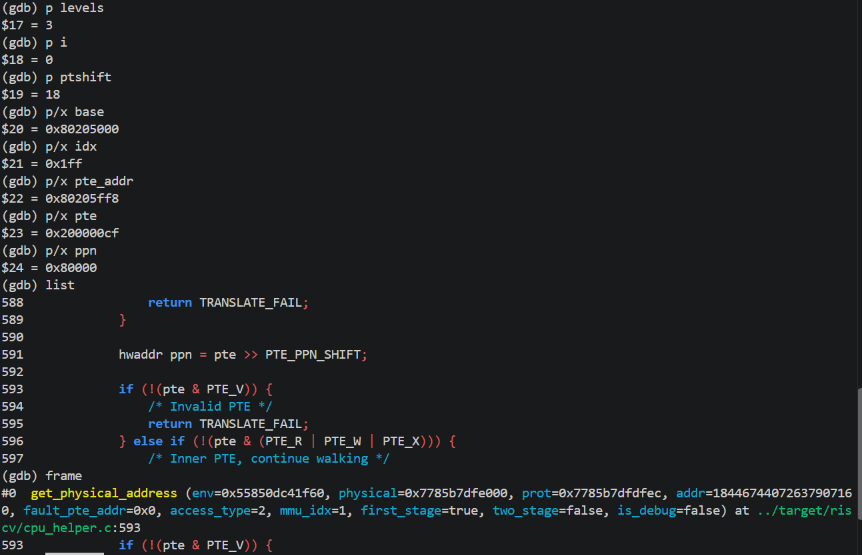
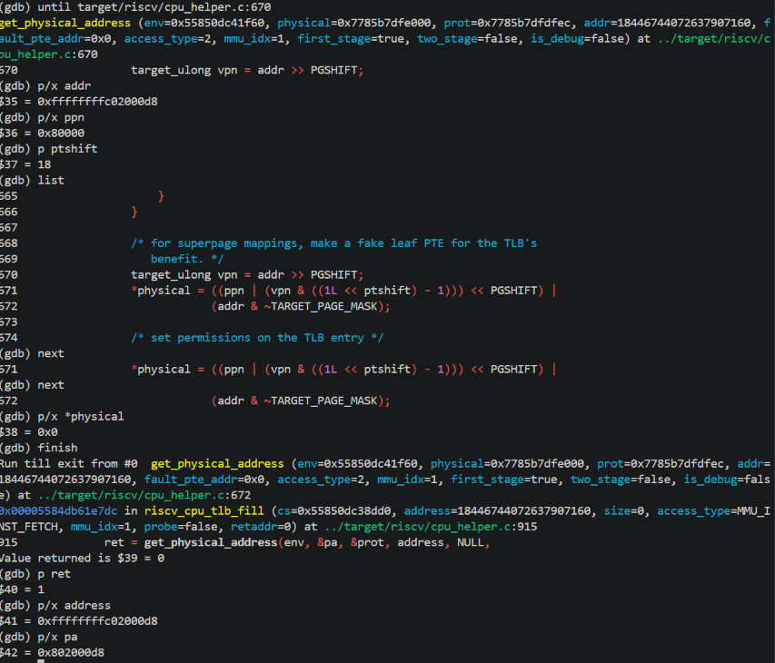
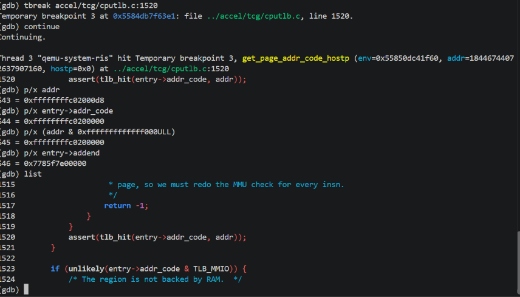
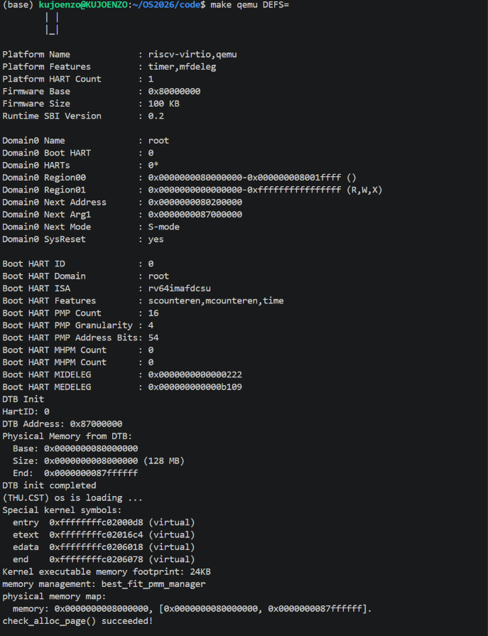
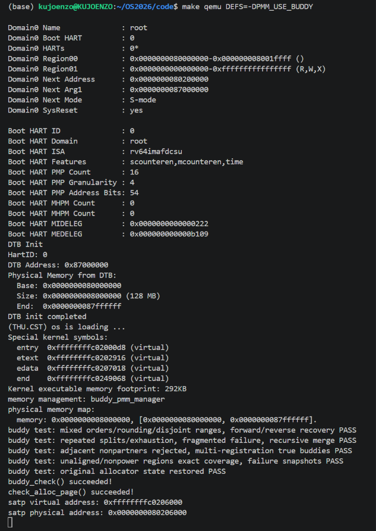
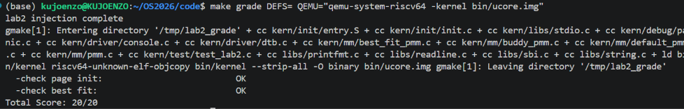

# 操作系统实验报告

## 实验基本信息

| 项目 | 内容 |
| --- | --- |
| **实验名称** | Lab 2：物理内存和页表（RISC-V ucore） |
| **小组成员** | 郝煦享、田茂炜 |
| **主体功能完成日期** | 2026-10-22 |
| **报告修订日期** | 2026-10-23 |
| **仓库** | [KujoEnzo/OS2026](https://github.com/KujoEnzo/OS2026) |
| **工作分支与基线** | `codex/lab2-module2`；`209c4383c9eb600f91b2b3f2502c1f4f27e2b6d3` |
| **实验提交分支** | `lab2` 分支；保留模块一合并历史 |

### 小组分工

| 成员 | 负责内容 |
| --- | --- |
| 田茂炜 | 功能模块一：物理内存初始化与运行验证 |
| 郝煦享 | 功能模块二：First-Fit 分析、Best-Fit 与 Buddy 实现、Buddy 测试、双 GDB 调试及报告整理 |

## 一、实验目的

1. 理解物理内存探测和按页管理：读取设备树内存范围，建立 `Page` 描述符，排除固件、内核和管理数据占用页。
2. 理解页表的建立与使用，区分虚拟地址、物理地址、物理页号及描述符地址，分析现有 Sv39 启动映射。
3. 理解连续页分配：分析 First-Fit，实现 Best-Fit 与 Buddy，比较分配策略、连续性约束及内外部碎片。
4. 学习用明确规格约束 AI 生成代码，以独立模型、计数守恒、区间不重叠和回收能力验证正确性。

## 二、实验环境

### 2.1 AI 工具登记

| 成员 | AI 编程工具 | 底层模型（个人登记） | 登记来源 |
| --- | --- | --- | --- |
| 郝煦享 | Codex | GPT-6Astra | Lab1 个人工具登记 |
| 田茂炜 | Codex | GPT-6.1Sol | Lab1 个人工具登记 |


### 2.2 实际构建与运行环境

| 项目 | 本次记录 |
| --- | --- |
| 系统环境 | Windows、WSL，实例 `CosyVoice_Env`，用户 `kujoenzo` |
| 仓库与构建目录 | `/home/kujoenzo/OS2026`、其下 `code/` |
| 交叉编译器 | `riscv64-unknown-elf-gcc 10.2.0` |
| 构建工具 | GNU Make 4.3 |
| 模拟平台与固件 | QEMU 6.2.0，`virt`，OpenSBI 0.9，日志为单 HART |
| 主机与内核调试器 | GNU GDB 12.1 调试 QEMU；`gdb-multiarch 12.1` 调试 RISC-V 内核 |
| 调试版 QEMU | 6.2.0，`--enable-debug` 构建；`/home/kujoenzo/qemu-6.2.0/build/qemu-system-riscv64` |
| GDB 远程接口 | QEMU `-s -S`，内核 GDB 连接 `127.0.0.1:1234` |
| RAM 与页大小 | 默认128 MiB，`[0x80000000,0x88000000)`；4 KiB/页 |
| 内核起点 | 物理 `0x80200000`，虚拟 `0xffffffffc0200000` |
| 编译产物 | `code/bin/kernel`、`code/bin/ucore.img` |
| 主机补充验证 | GCC、ASan/UBSan；包含实际分配器源码，使用模拟描述符和独立位图模型 |

编译、QEMU 启动与主机补充验证均在上述环境中执行。各开发阶段的命令输出和测试结果归档于 `report/logs/`，对应关系见第五章。

## 三、实验整体逻辑分析

### 3.1 本章节的逻辑主线

Lab1 让内核获得控制权，Lab2 进一步回答“哪些物理页可用、怎样组织和分配、内核如何寻址这些页”。页表建立访问关系，分配器记录资源归属；有映射不意味着对应 RAM 实际存在或可分配。

### 3.2 功能的逐步实现

1. **沿用启动映射并解析 DTB。** 汇编保存固件传入的信息并设置 Sv39，C 入口清零 BSS 后取得 RAM 起点和长度。
2. **初始化管理器并建立描述符。** 管理结构先就绪，`page_init()` 才能把排除保留区后的完整页交给它。
3. **分析 First-Fit，再实现 Best-Fit。** 先掌握统一接口、拆分与合并，再改变选块策略并切换实际 manager。
4. **实现 Buddy，另行设计测试。** 明确绝对页号伙伴、取整和释放契约，再验证与 Best-Fit 不同的边界。
5. **分层验证。** 编译核对接入，QEMU 核对启动和 `.check`，主机独立模型补充边界，官方评分只代表其覆盖范围。
6. **双层调试地址转换。** 主机GDB调试QEMU，内核GDB控制RISC-V；以C入口取指地址观察软件TLB查询、Sv39根级叶子翻译及缓存填充，并与Bare模式对照。

```text
kern_entry → kern_init → dtb_init → pmm_init
  → init_pmm_manager → manager.init
  → page_init → init_memmap → manager.init_memmap
  → check_alloc_page → manager.check

alloc_pages / free_pages / nr_free_pages → 当前 manager 对应方法
```

### 3.3 数据结构与地址关系

`Page *` 指向管理数据而非页内容；`p+n` 移动 n 个描述符，对应物理地址增加 `n*PGSIZE`。当前转换为：

```text
page2ppn(p) = p - pages + nbase
page2pa(p)  = page2ppn(p) << PGSHIFT
PA         = kernel_VA - va_pa_offset
```

`npage` 是绝对物理页号上界，描述符数量为 `npage-nbase`。`ref` 记录引用数，`PG_reserved` 表示保留；`PageProperty` 只标记空闲块首，内部页归属由块区间和分配器元数据确定。块首 `property` 记录页数，`nr_free` 统计空闲页数。框架通过 [pmm.h](../code/kern/mm/pmm.h) 的六个函数指针使用不同算法。

## 四、实验内容与实现

本章顺序对应 [课程练习](http://oslab.mobisys.top/lab2026/_book/lab2/lab2_2_1_exercise.html)。以下规格采用 [课程提示词结构](http://oslab.mobisys.top/lab2026/_book/lab0.5/3_prompt_structure.html)：模块一规格根据已有实现整理，模块二规格根据开发请求归纳；实际任务摘录见 [prompt.md](prompt.md)。

### 4.1 功能模块一：物理内存初始化

**负责人：** 田茂炜，沿用已合入实现；本次后续开发保留 `page_init()`。

#### 功能与核心函数

```c
static void page_init(void); // 本任务实现，位于 kern/mm/pmm.c
```

依赖 DTB 查询接口、`end`、`PADDR`、`pa2page`、页对齐及状态宏、`init_memmap`、`panic` 和 `cprintf`。函数设置虚实偏移，拒绝零长度、地址加法溢出和与固定 `nbase` 不兼容的范围；末端限制为 DTB 末端与框架上界较小者，并向下按页对齐。

将 `PADDR(end)` 向上对齐后放置描述符数组，以除法检查数组容量避免乘法溢出。全部描述符先设为保留、引用数和长度清零、节点初始化；仅把数组之后到管理末端的完整页注册。无剩余完整页时不调用零长度 `init_memmap()`。

```text
DRAM_BASE → 固件保留区 → 内核镜像 → 对齐间隙 → Page 数组
          → 对齐间隙 → 可分配完整页 → 管理末端
```

描述符本身也占物理内存。Buddy 静态元数据和自检工作区属于 BSS，随镜像自然保留。当前框架解析 DTB 后不再长期使用它；本实现没有扩展为通用设备树保留区、多 RAM bank 或热插拔管理。

#### 功能规格提示词（根据实现整理）

```text
[PROMPT]
在 kern/mm/pmm.c 实现 page_init，连接 DTB 内存信息与当前分配器。
修改真实文件，保留框架和 lab2 标记，只完善初始化。
[RELY]
读取实际 pmm.h、memlayout.h、mmu.h 和 DTB 接口；使用查询、地址转换、
对齐、页状态、引用数、init_memmap、panic 和输出接口。
[GUARANTEE]
static void page_init(void);
正确设置 va_pa_offset、npage、pages，输出范围并注册可用完整页。
[SPECIFICATION]
Pre-Condition：启动映射、DTB 解析和 manager.init 已完成。
Post-Condition：每个管理页有描述符，固件、内核和描述符占用页保留。
Case 1：范围有效时限制上界，按页布局描述符和空闲区，注册剩余完整页。
Case 2：零长度、溢出、不支持的起点或数组放不下时 panic。
Case 3：无剩余完整页时不调用 init_memmap。
Requirements：不得混用 VA、PA、PPN 与描述符地址，检查容量和对齐。
```

#### 迭代与结果

模块一完成提交为 `af1d6fa`。原运行日志记录128 MiB物理内存、`default_pmm_manager` 和框架检查成功，对应切换 Best-Fit 前的代码阶段。后续完整性核验确认 `page_init()` 保持不变。归档包含完成版本与运行结果，不包含中间失败版本和逐轮提示词。[模块一日志](logs/lab2-module1-run2.log)、[完整性核验](logs/buddy-check/integrity.log)。

### 4.2 Challenge 思考题：未知硬件内存范围怎样获取

OS 从平台约定的内存描述取得可用内存范围，编译时管理上界只限制本内核的管理容量。本实验接收固件传递的 DTB 地址，解析内存节点的起点和长度，再应用管理上界；这一过程读取已有的硬件描述，不执行逐地址内存探测。[课程物理内存探测](http://oslab.mobisys.top/lab2026/_book/lab2/lab2_3_5_2_search_phymem_layout.html)

引导协议或固件内存映射提供可用 RAM 与保留区后，OS 还要校验范围溢出、排序和重叠，排除 MMIO、固件及内核占用，再逐段注册完整页。访问无效地址会触发异常，写入 MMIO 会改变设备状态，因此本实验通过 DTB 获取内存布局。本题完成原理分析，未新增平台探测或多区间 DTB 解析代码。

### 4.3 功能模块二任务一：理解 First-Fit

**分析署名：** 郝煦享、田茂炜。

核心函数位于 [default_pmm.c](../code/kern/mm/default_pmm.c)：

```c
static void default_init(void);
static void default_init_memmap(struct Page *base, size_t n);
static struct Page *default_alloc_pages(size_t n);
static void default_free_pages(struct Page *base, size_t n);
static size_t default_nr_free_pages(void);
```

`default_init()` 初始化空闲链表并清空计数。`default_init_memmap()` 接收可用页，清理元数据，以块首记录长度，按地址插入链表。`default_alloc_pages(n)` 从低地址开始选择第一个足够大的块；摘下原块，必要时将尾部剩余块挂回原位置。`default_free_pages()` 按地址插入释放块，再检查前后块是否在物理上连续并合并。`nr_free` 统计空闲页总数，不是块数；合并不应重复增加计数。

例如按地址排列的空闲块长度为8、3、6页，申请3页时 First-Fit 选择8页块并留下5页；Best-Fit 选择恰好3页的块。设空闲块数为F，当前链表实现的分配查找与释放定位最坏时间复杂度均为O(F)。

大小分类索引和平衡树通过额外索引组织空闲块，拆分和合并时同步更新索引。Next-Fit 从上次搜索位置继续查找。Best-Fit 拆分后的短小余块仍构成外部碎片，两种策略的碎片率和分配耗时取决于请求负载。

### 4.4 功能模块二任务二：Best-Fit

**实现记录：** 本次 kujoenzo 工作目录；小组署名郝煦享、田茂炜。

#### 功能与接口

```c
static void best_fit_init(void);
static void best_fit_init_memmap(struct Page *base, size_t n);
static struct Page *best_fit_alloc_pages(size_t n);
static void best_fit_free_pages(struct Page *base, size_t n);
static size_t best_fit_nr_free_pages(void);
static void best_fit_insert_block(struct Page *base); // 私有辅助函数
static void basic_check(void);                       // 原测试，未改
static void best_fit_check(void);                    // 原测试，未改
extern const struct pmm_manager best_fit_pmm_manager;
```

相关文件为 [best_fit_pmm.c](../code/kern/mm/best_fit_pmm.c)、[best_fit_pmm.h](../code/kern/mm/best_fit_pmm.h) 和 [pmm.c](../code/kern/mm/pmm.c)。原 `.pending` 文件补全后恢复为 `.c`；Makefile已通过目录和扩展名自动收集源码，没有重复加入源文件。

实现保留 `static free_area_t free_area`，用宏提供原测试直接访问的 `free_list`、`nr_free`。链表按物理地址升序，仅空闲块首设置 `PageProperty` 和非零长度。

分配扫描所有满足长度要求的块，只在找到严格更小的块时更新候选；因此同大小保留低地址块。遇到完整匹配可提前退出。成功时从块首分配，尾部剩余块留在原位置；清理分配区每页的块首标志、长度、引用数和节点，并减去n页。总量不足或没有连续块时返回 `NULL`，不修改状态；零长度沿用断言约定。

初始化与释放复用按地址插入辅助方法，先合并连续前块，再检查合并结果与后块。被吞并块首清除标志、长度并摘链；只在新页加入或释放时增加计数。

注册对象实现全部六个方法；`.check` 指向原 `best_fit_check()`，其中继续调用原 `basic_check()`。两个测试的完整文本逐字节保留，评分脚本和注入测试未改。普通QEMU打印实际名称 `best_fit_pmm_manager` 并通过原检查。补充主机测试以独立位图模型核对20,000次操作，覆盖低地址平局、拆分、合并、失败不改状态及零长度断言。见 [Best-Fit启动日志](logs/best-fit/qemu.log) 和 [补充测试](logs/best-fit/boundary.log)。

#### 最终提示词（按实际请求规范化）

```text
[PROMPT]
先读 pmm.h、memlayout.h、pmm.c、default_pmm.c、best_fit_pmm.h、
best_fit_pmm.c.pending 和 list.h，实现完整 Best-Fit 并默认接入。
先给设计与验证办法，再改真实文件；恢复 .pending 为 .c。
保留 page_init、lab2 标记和两个原测试，不改评分脚本或注入测试。
[RELY]
实际 pmm_manager、Page、free_area_t、链表及页状态/引用数宏。
原测试需直接使用 free_list/nr_free；核对自动收集规则，避免重复加源文件。
[GUARANTEE]
实现 init、init_memmap、alloc_pages、free_pages、nr_free_pages、check
及 const best_fit_pmm_manager；init_pmm_manager 默认选择该对象。
[SPECIFICATION]
init：Pre 为启动阶段；Post 为空链表、nr_free=0。
init_memmap：Pre 为有效保留页和 n>0；Post 注册全部页、更新计数。
alloc_pages：Pre 为 n>0；Post 成功返回连续 n 页且恰减 n，失败不改状态。
  Case 1：选最小足够块，同大小取低地址，精确匹配可提前结束。
  Case 2：拆分尾块或完整摘链，清理分配区 PageProperty/property/ref。
  Case 3：总量或连续块不足返回 NULL，n=0 沿用断言。
free_pages：Pre 为合法分配区间及 n>0；Post 按地址插入，只加回 n 页，
  合并物理连续的前后块，并清理被吞并块首的标志与节点。
nr_free_pages：只读返回真实空闲页数。
check：仍执行原 basic_check/best_fit_check。
Requirements：实际编译、QEMU 确认 manager，再 make grade；解释失败与未跑项。
```

#### 实现迭代与问题解决

Best-Fit 开发分为实现与验证两个阶段。实现阶段完成空闲链表、分配释放方法、注册对象和默认管理器切换，并核对构建规则只收集一次分配器对象。验证阶段定位了两项环境问题：额外启用的 `-Wextra` 使原测试的类型比较触发告警，测试工具随后采用工程告警选项并保留检测器；原样评分未进入内核，随后使用同一镜像补充启动参数进行对照。两项诊断均保留原测试，详见第五章。

工程构建、QEMU 原检查及20,000次独立模型验证均通过。原样评分结果为0/20，补充兼容启动参数后的结果为20/20；两组结果分别归档。

#### 思考题：Best-Fit 是否有进一步改进空间

有。当前最坏扫描 F 个空闲块，逐页清理另有与页数有关的成本。可同时维护地址索引及以“长度、地址”为键的平衡树，加快最小足够块查找并保留低地址平局；代价是拆分与合并时要一致更新两个索引，增加元数据和验证成本。这一优化未实现。

Best-Fit 不消除外部碎片。比较分配策略时，评价指标包括相同负载下的失败率、最大连续块、碎片分布和耗时。小对象缓存在页内划分对象槽，处理页级分配之外的小粒度请求；本次未实现 SLUB 扩展。

### 4.5 功能模块二任务三：Buddy System

**实现记录：** 本次 kujoenzo 工作目录；小组署名郝煦享、田茂炜。

#### 功能与接口

```c
static void buddy_init(void);
static void buddy_init_memmap(struct Page *base, size_t n);
static struct Page *buddy_alloc_pages(size_t n);
static void buddy_free_pages(struct Page *base, size_t n);
static size_t buddy_nr_free_pages(void);
static void buddy_check(void);
static void buddy_validate(void); // 内部结构验证
extern const struct pmm_manager buddy_pmm_manager;
```

新增 [buddy_pmm.c](../code/kern/mm/buddy_pmm.c)、[buddy_pmm.h](../code/kern/mm/buddy_pmm.h)，注册 `buddy_pmm_manager`；`pmm.c` 根据 `PMM_USE_BUDDY` 选择管理器，默认保持 Best-Fit。

#### 坐标系与初始区间

第order阶块包含 `2^order` 页，块首在**绝对物理页号**上对齐：

```c
ppn = page2ppn(base);
buddy_ppn = ppn ^ ((size_t)1 << order);
```

`ppn-nbase` 仅用于元数据索引，不能直接用作伙伴编号。转换伙伴为Page指针前，先验证下界、`npage`、物理内存上界及元数据容量；再确认整个块已注册、没有保留页，且候选是同阶空闲块首。只有这些真正伙伴才能合并，相邻同大小不构成充分条件。

`init_memmap()` 先完整验证输入，随后把区间分解为绝对页号对齐且不超过剩余长度的幂次块。不裁掉不对齐前缀，也不向区间外取整。多次调用累积注册，可跨调用合并真正空闲伙伴；保留空洞不进入分配范围，重叠和越界注册断言失败。

#### 元数据与分配释放契约

不修改 `struct Page`。静态 `buddy_page_meta` 表记录原请求、阶数和状态，区分未注册、内部页、空闲块首和分配块首。当前物理上界限定最多32768项，最大阶为15。RV64符号表记录该表为262144字节（256 KiB），各阶链表头256字节，计数8字节。静态BSS属于内核镜像，由原 `page_init()` 保留，不依赖分配器动态取得自身元数据。后加的测试工作区另占静态BSS，不包含在上述元数据表尺寸中。

`alloc_pages(n)` 向上取整后占用完整块，记录原始n和实际阶数；如申请3页实际占4页，空闲计数减4。先限制容量，再在最大阶范围内移位，避免取整溢出。仅在找到可用阶后才修改状态，并逐级拆分大块。

`free_pages(base,n)` 必须传原请求3，而不是实际占用4；验证块首和原请求后，按记录释放完整块并递归合并伙伴，计数加4。内部页、重复释放和不同原请求均不接受。

阶链表的查找和拆分层数受最大阶限制。本实现还执行逐页元数据清理和注册范围扫描，完整操作成本包含这些线性扫描，不能仅计为O(log N)。范围记录和位图是进一步优化元数据访问的方向，优化后的检查仍须覆盖空洞与保留页。

#### 第一份提示词：生成并接入 Buddy（实际请求规范化）

```text
[PROMPT]
先读 pmm.h、memlayout.h、pmm.c、list.h、default_pmm.c、Best-Fit 和 Makefile。
在真实仓库新增 buddy_pmm.c/.h，先解释设计再实施，保留 page_init 和原测试。
默认 Best-Fit，用 PMM_USE_BUDDY 切换，并打印实际 manager 名称。
[RELY]
使用现有六方法、Page 数组/换算、链表接口；每阶块为 2^order 页。
伙伴为绝对 PPN XOR (1<<order)，元数据下标才用 ppn-nbase。
[GUARANTEE]
实现 buddy_init/init_memmap/alloc_pages/free_pages/nr_free_pages/check，
注册 const buddy_pmm_manager，说明静态元数据容量与 DEFS 切换方法。
[SPECIFICATION]
init：Pre 为启动初始化；Post 清空所有阶链表、元数据、计数。
init_memmap：Pre 为 n>0、未注册保留页；Post 完整覆盖区间且保留既有注册。
  Case 1：不对齐、非幂长分解为合法幂次块，不裁剪、不超出输入。
  Case 2：多次注册可合并真正伙伴；空洞不可分配，重叠/越界断言。
alloc_pages：Pre n>0；Post 成功占 ceil_pow2(n) 页，记录原 n 和阶数。
  Case 1：找到足够阶后连续拆分，按真实块页数扣计数。
  Case 2：总量或目标阶不足返回 NULL，任何状态不变。
  Case 3：超容量先拒绝，再受阶数上界限制取整，防止移位溢出。
free_pages：Pre 为分配块首与完全相同的原 n；Post 释放记录的整块。
  仅合并已注册、同阶、空闲、为块首的 XOR 伙伴，不能仅凭相邻合并。
nr_free_pages：统计真实页数，申请3页占4页、释放传3。
check：接到 manager 框架检查；强化测试由第二份任务单独完成。
Requirements：形成 Page 指针前检查数值上下界，不依赖自身动态分配元数据。
```

#### 第二份提示词：设计对应测试（实际请求规范化）

```text
[PROMPT]
先读已生成 Buddy 的调用、元数据和释放契约，再给测试矩阵并实施。
测试接到 buddy_pmm_manager.check，不改 Best-Fit 原测试和评分文件。
[RELY]
真实实现按绝对 PPN 算伙伴；alloc(n)占取整整块，free(base,n)传原请求。
可使用静态受控描述符，但不能通过动态分配取得自身工作区。
[GUARANTEE]
完善 buddy_check 及私有辅助测试，说明各场景触发方法、取得/恢复区域方式。
实际编译、QEMU 验证，给真实日志及未验证项。
[SPECIFICATION]
Pre-Condition：启动阶段，无并发、非重入；允许原状态已有活动分配。
Post-Condition：全部测试结束后真实 Page、元数据、链表和计数完整恢复。
Case 1：单页、多阶和非幂次申请，手工核对真实占用与所有存活区间。
Case 2：连续拆分、正序/逆序释放、递归合并后可重新申请大块。
Case 3：相邻非伙伴不得合并，多次注册真正伙伴可合并。
Case 4：不对齐、非幂长和带空洞初始区域覆盖所有且仅注册页。
Case 5：空表、耗尽、碎片、超容量失败前后快照相同。
Requirements：计数守恒 + 区间不重叠/范围/对齐 + 大块再分配交叉验证；
不依赖物理起点或返回顺序。panic 参数作为独立负面测试，不能中断主矩阵。
```

#### 核心辅助函数

`buddy_page_index()` 先核对数值地址、对齐和边界再取得索引；`buddy_block_registered()` 先验范围再逐页排除空洞和保留页。`buddy_link_free()/buddy_unlink_free()` 同步维护阶链表及块首状态；`buddy_free_partner()` 检查 XOR 伙伴；`buddy_release_block()` 递归合并，计数由外层统一更新。`buddy_validate()` 验证覆盖、元数据、链表和计数，并确认没有遗留可合并伙伴。

#### 测试覆盖与隔离恢复

私有 [buddy_pmm_check.h](../code/kern/mm/buddy_pmm_check.h) 经 `buddy_check()` 接入启动自检。每个分配都有独立记录的原请求和手工给定的实际占用，并同时验证：

1. `空闲页数 + 活动分配真实占用 = 注册页数`；
2. 同时存活的区间互不重叠、处于管理范围、满足绝对页号对齐；
3. 全释放后能够再次申请大块，而非仅恢复计数。

| 场景 | 具体触发与断言 |
| --- | --- |
| 单页、多阶、非幂次 | 从32页块同时申请1、2、3、5、8页，实际占用1、2、4、8、8，剩余9页 |
| 正序、逆序释放 | 分别按分配顺序和逆序回收上述分配，计数恢复32并重新申请32页块 |
| 连续拆分、耗尽 | 唯一32页块分配为32个单页；检查全部区间，下一次申请失败 |
| 总量足够但碎片不足 | 按实际PPN只释放偶数页，空闲16页但申请2页失败；释放其余页后重获32页块 |
| 相邻非伙伴 | 注册对齐根+1与根+2单页，总量2但申请2失败；补注册根及根+3后可申请4页 |
| 不对齐、非幂长、空洞 | 注册根+1起23页及根+28起3页，恰好分配26个单页；回收后可再申请8页 |
| 失败状态不变 | 空表、耗尽、碎片、超容量、SIZE_MAX请求前后逐字节比较描述符、元数据、链表头与计数 |
| 全局恢复 | 已有两个活动分配时连续调用两次check，所有真实模拟描述符、完整元数据表、链表头、指针和计数逐字节一致 |

受控区域为静态64个模拟Page，只测试描述符，不读写它们代表的物理页内容。进入前保存真实 `pages/npage`、前64项元数据、全部链表头和计数；临时切换到模拟数组并缩小范围，保证其余元数据不可达。不能调用清空整个表的 `buddy_init()`。测试后恢复全部保存字段，原真实节点未写，因此恢复哨兵头即可还原原链表。

对齐根由 `ROUNDUP(nbase,32)` 计算，最多偏移31，32页块始终位于64项数组中；碎片页按实际PPN选择，不依赖分配返回顺序。旧check中操作真实链表的简单分配循环已移除。此隔离方法只用于启动阶段，要求无并发、非重入。

负面测试在主机独立子进程中运行：三个零长度调用、原请求不匹配、内部页释放、双重释放、重叠注册和越界注册。父进程必须确认全部8项按预期断言终止才报告成功；主启动测试没有通过一次panic冒充全部通过。另在实验树外副本制造错误计数和禁用合并，两者均被新自检检出，正式源码未加入这些错误。

QEMU实际输出见 [最新Buddy启动日志](logs/buddy-check/buddy-qemu.log)：

```text
memory management: buddy_pmm_manager
buddy test: mixed orders/rounding/disjoint ranges, forward/reverse recovery PASS
buddy test: repeated splits/exhaustion, fragmented failure, recursive merge PASS
buddy test: adjacent nonpartners rejected, multi-registration true buddies PASS
buddy test: unaligned/nonpower regions exact coverage, failure snapshots PASS
buddy test: original allocator state restored PASS
buddy_check() succeeded!
check_alloc_page() succeeded!
```

#### 迭代过程与关键改进

Buddy 开发分为算法实现与自检强化两个阶段。第一阶段完成分配器、编译宏切换、绝对 PPN 伙伴计算、原请求释放契约、静态容量限制和多区间注册，并通过 QEMU、独立模型、容量测试与负面断言验证。

第二阶段以隔离矩阵替换原 check 中的少量真实分配释放：引入64描述符静态区域，移除真实链表循环，增加失败快照与独立预期，并在已有活动分配的条件下连续调用两次 check，逐字节比较全部保存状态。测试工作区位于 BSS，避免占用仅两页的内核启动栈。两种故意错误副本均被检出。完成自检强化后，两种 manager 均通过干净构建与 QEMU 启动检查。2026-10-23 09:48的复测再次验证两种模式，并在同一源码基线上记录原样评分0/20、兼容启动参数评分20/20，证据见第5.1节。

### 4.6 Challenge：SLUB 任意大小对象分配

**未实现。** SLUB 在页级分配器之上划分不同大小的对象槽，以对象缓存处理小粒度请求。本报告说明其基本结构，代码与测试范围不包含 SLUB。

### 4.7 页表与 TLB 及双 GDB 调试实测

#### 4.7.1 启动映射与两种调试器

[entry.S](../code/kern/init/entry.S) 的Sv39根表按4 KiB对齐，512项中前511项无效，末项为 `(0x80000 << 10) | 0xcf`，V/R/W/X/A/D置位。该根级叶子项把虚拟 `0xffffffffc0000000` 起的1 GiB窗口映射到物理 `0x80000000` 起窗口。映射窗口不等于可分配RAM容量，后者仍受DTB、128 MiB上界和保留页限制。

入口将页表物理页号和MODE=8写入 `satp`，执行 `sfence.vma`，再使用高地址栈并跳转C入口。本次默认Best-Fit调试镜像的根表物理地址是 `0x80205000`；Buddy启动镜像中为 `0x80206000`。两者是不同镜像的布局，不能混用页表基址。本次 `kern_init` 符号为 `0xffffffffc02000d8`。

本次完成[课程双GDB调试任务](http://oslab.mobisys.top/lab2026/_book/lab2/lab2_4_qemu_mmu_debug.html)中的地址翻译、TLB查询和Bare对照。终端A运行带调试信息的QEMU 6.2.0；B用x86-64主机GDB附加QEMU；C用 `gdb-multiarch` 连接QEMU的RISC-V GDB stub。仓库 `make gdb` 写死的 `riscv64-unknown-elf-gdb` 在本机不存在，因此本次直接调用已安装且支持RISC-V的 `gdb-multiarch`，未把命令名缺失写成GDB未安装。

条件断点选择C入口取指地址，翻译函数条件包含 `!is_debug`，排除GDB读内存引起的调试翻译。主机GDB暂停QEMU时，内核GDB必须等待；先在B继续QEMU，C才能响应。复现命令见第5.3节。

#### 4.7.2 实际调用路径与关键分支

Bare取指时的 `bt` 实际记录了以下调用关系；高地址截图继续展示同一取指查询函数进入翻译函数：

```text
cpu_exec → tb_lookup → tb_htable_lookup
  → get_page_addr_code → get_page_addr_code_hostp
  → tlb_fill → riscv_cpu_tlb_fill → get_physical_address
```

本机QEMU源码中，`accel/tcg/cputlb.c:1506` 检查取指TLB，未命中后检查victim TLB，再调用 `tlb_fill`。`target/riscv/cpu_helper.c:499` 根据地址转换模式分支；第593行开始检查已读PTE，区分无效、非叶子和叶子；第670—672行计算大页物理地址。翻译和PMP检查成功后 `riscv_cpu_tlb_fill` 调用 `tlb_set_page`，填充完成的截图停在 `cputlb.c:1520` 的命中断言。这里的行号均按本机实际源码核对。

#### 4.7.3 Bare模式：不遍历页表

物理入口取指时实际记录 `addr=0x80200000`、`env->satp=0`、`env->priv=1`、`is_debug=false`、`vm=0`。执行进入Bare分支的 `*physical = addr`，`finish` 返回0，保存的输出指针内容为 `0x80200000`。这次访问在S模式下未启用分页，虚实地址相同，没有进行Sv39页表读取。





#### 4.7.4 Sv39模式：软件TLB未命中与根表叶子

跳到C入口时，截图记录如下：

| 变量 | 实测值 | 含义 |
| --- | --- | --- |
| `addr` | `0xffffffffc02000d8` | 本次C入口取指地址 |
| `env->satp` | `0x8000000000080205` | MODE=8，根页表PPN为 `0x80205` |
| `mmu_idx` / `index` | `1` / `0` | S模式的软件TLB索引 |
| 填充前 `entry->addr_code` | `0xffffffffffffffff` | 无有效的对应取指缓存项 |
| 目标4 KiB页地址 | `0xffffffffc0200000` | 本次查询的目标虚拟页 |

单步实际进入 `!tlb_hit(...)` 分支，检查victim TLB后调用翻译函数，截图同时显示 `is_debug=false`，因此观测对象是模拟CPU取指。


在 `get_physical_address` 读取PTE后，实际变量为：

| 变量 | 实测值 |
| --- | --- |
| `levels` / `i` / `ptshift` | `3` / `0` / `18` |
| `base` | `0x80205000` |
| `idx` | `0x1ff`，即511 |
| `pte_addr` | `0x80205ff8 = 0x80205000 + 511 × 8` |
| `pte` / `ppn` | `0x200000cf` / `0x80000` |

`i=0` 是QEMU循环的第一次迭代，对应Sv39根级（体系结构level 2）。PTE的V及R/W/X置位，属于根级叶子，代表1 GiB大页；没有进入下两级。Sv39最多三级与本次实际读取一级是两件事。



#### 4.7.5 大页物理地址计算与软件TLB填充

根级叶子的 `ptshift=18`，将低18位VPN与页内偏移并入物理地址。本例等价于：

```text
PA = 0x80000000 + (VA & 0x3fffffff)
   = 0x802000d8
VA = 0xffffffffc02000d8
```

截图中两次 `next` 后仍停在跨行赋值的第672行，此时 `*physical=0` 是赋值尚未完成的中间状态。随后 `finish` 显示函数实际返回0，调用者中的 `address=0xffffffffc02000d8`、`pa=0x802000d8`，证明本次转换完成。返回点仍在第915行的调用赋值处，局部 `ret` 保留初始化值1；不能把这个旧局部值当成本次翻译函数返回值。复现时运行到第674行再读物理地址，返回调用者后再单步完成 `ret` 赋值。



继续运行到软件TLB填充后的第1520行，`entry->addr_code` 已变为 `0xffffffffc0200000`，与目标虚拟页地址相同。本次证据包含未命中、页表转换和填充后缓存状态；未另做第二次访存直接命中的独立截图。`entry->addend` 用于把guest虚拟地址转换为QEMU进程的主机内存地址，不能当作guest物理地址；guest物理地址以 `pa` 为证。



#### 4.7.6 真实CPU TLB与QEMU软件TLB的差异

真实RISC-V CPU的地址翻译缓存服务于分页地址转换；Bare模式跳过分页转换。QEMU运行在宿主进程中，软件TLB还缓存guest访问对应的主机内存位置、权限及RAM/MMIO处理信息，所以Bare取指的实际调用栈仍经过软件TLB查询和填充入口，但转换函数直接返回原地址。开启Sv39后，未命中才增加本次根页表读取和权限检查。软件TLB不能与真实CPU的硬件结构逐项等同。

#### 4.7.7 调试问题、AI辅助与恢复后的实际位置

1. 安装依赖时将包名当作Python脚本运行，报 `can't open file .../wget`；改为完整 `sudo apt install` 命令。
2. GDB拒绝自动加载QEMU的 `.gdbinit`，但已成功显示翻译函数源码行。普通断点和变量查看无需该扩展脚本，本次未放宽全局安全路径。
3. 初版操作单使用的源码行号与本机构建不一致；读取本机源码后修正断点位置。`list` 只改变源码显示，使用 `frame` 确认实际执行到第593行。
4. C启动命令尾部续行符把下一行拼成 `bin/kernelset pagination off`，内核未加载，`hbreak *kern_init` 报无符号表。B恢复运行后在C中按Ctrl+C，以绝对路径 `file` 补载内核并检查寄存器。

恢复后的C截图实际显示 `PC=0xffffffffc0200110`，即 `kern_init+56` 的自循环；`satp=0x8000000000080205`。读取虚拟页表项地址 `0xffffffffc0205ff8` 得到 `0x200000cf`，与主机GDB观测到的PTE一致。该图是恢复后停点，不是成功命中最初C入口断点。左右终端分别调试QEMU进程和被模拟的RISC-V内核。


本节依据终端截图记录调试现象和技术处理；代码生成提示词统一见 [prompt.md](prompt.md)。

## 五、测试与验证

### 5.1 分阶段验证与证据

下表按开发阶段列出。早期日志的复制校验值见 `logs/archive-manifest.json`；2026-10-23 09:48复测在源码副本中执行，基线为 `7db2f61`，原样日志与结果见 `logs/final-verification-20261023/`。本次文档归档未再次运行编译或评分。

| 阶段 | 实际执行及结果 | 证据 |
| --- | --- | --- |
| 模块一 | DTB 128 MiB、First-Fit原检查成功 | [原日志](logs/lab2-module1-run2.log) |
| Best-Fit实现 | 干净编译、QEMU原检查；20,000次位图模型操作 | [构建](logs/best-fit/build.log)、[模型](logs/best-fit/boundary.log) |
| Best-Fit评分 | 原样0/20；兼容启动参数20/20 | [原结果](logs/best-fit/grade.log)、[兼容结果](logs/best-fit/grade-compatible.log) |
| Buddy初始实现 | 两模式构建和启动；30,000次模型操作；独立8类断言 | [Buddy启动](logs/buddy/buddy-qemu.log)、[模型](logs/buddy/boundary.log) |
| Buddy最高阶 | 32767取整占32768；32768次单页分配及完整回收 | [容量测试](logs/buddy/capacity.log) |
| Buddy阶段默认评分 | 原样0/20；兼容启动参数20/20 | [原结果](logs/buddy/grade-original.log)、[兼容结果](logs/buddy/grade-compatible.log) |
| 最新隔离矩阵 | Buddy与默认模式均重新干净编译、QEMU检查成功 | [Buddy构建](logs/buddy-check/buddy-build.log)、[默认启动](logs/buddy-check/default-qemu.log) |
| 最新恢复验证 | ASan/UBSan；活动分配下两次check，真实模拟状态逐字节不变 | [恢复验证](logs/buddy-check/restore.log) |
| 最新补充验证 | 30,000次模型操作、8类负面断言、两种故意错误检出 | [模型与负面](logs/buddy-check/negative-model.log)、[变体](logs/buddy-check/mutation.log) |
| 最新完整性 | 分配器方法、Best-Fit、page_init、公开头文件和评分文件不变 | [核验](logs/buddy-check/integrity.log) |
| 2026-10-23最终源码复测 | Best-Fit与Buddy均干净构建并通过QEMU检查；原样评分0/20、兼容参数20/20 | [复测结果](logs/final-verification-20261023/results.json)、[兼容评分](logs/final-verification-20261023/grade-compatible.log) |
| 最终终端截图 | Best-Fit原检查成功；Buddy五组PASS及自检成功；显式兼容评分20/20 | 本节下方图5-1至图5-3 |
| 双GDB调试 | Bare对照、TLB未命中、Sv39根级叶子、VA→PA及填充状态 | 第4.7节图4-1至图4-7 |

QEMU在初始化后按原设计无限空转，验证工具读取成功输出后结束进程。开发记录中的退出码124表示达到时间上限；启动验证以实际manager名称和检查成功输出为通过标准。ASan/UBSan及故意错误副本验证在主机中执行。

以下为用户补充的原始终端截图；图片未改写内容，文件校验见 [图片清单](images/manifest.json)。







### 5.2 问题与定位依据

#### 原样评分未进入内核

本机QEMU 6.2/OpenSBI 0.9下，普通启动使用 `-kernel`，评分脚本仅使用 `-device loader`。评分失败日志的 `Domain0 Next Address` 为零，程序停在OpenSBI阶段，未进入DTB初始化；正常启动日志中的下一入口为 `0x80200000`。该组0/20结果对应内核未启动的评分过程。

保持同一评分镜像和原测试，补上 `-kernel` 后测试通过，再通过Makefile已有 `QEMU` 参数运行原评分流程得到20/20。评分脚本、注入器及测试均未修改。证据：[原评分启动日志](logs/best-fit/grade-original-qemu.log)、[单变量启动诊断](logs/best-fit/grade-boot-diagnostic.log)。原样评分在该环境仍失败，20/20仅对应明确记录的兼容参数。

评分中的 `test_best_fit()` 主要检查manager指针，分配行为由先执行的原 `best_fit_check()` 验证。官方评分覆盖物理内存初始化与 Best-Fit，Buddy 正确性由专项测试矩阵验证。2026-10-23复测已对该源码重新评分，原样0/20与兼容20/20分别归档；后者仍不代表Buddy获得官方计分。

#### 补充测试告警选项

Best-Fit主机测试首次额外启用 `-Wextra`，使原测试中 `int total` 与 `size_t` 的比较被 `-Werror` 拒绝。测试工具改用工程已有的 `-Wall -Wno-unused -Werror`，保留ASan/UBSan后通过，没有修改原测试。该首次告警未单独保存为日志文件，结论依据开发记录；最终构建日志有归档。

#### 自检覆盖与恢复要求

Buddy 最初的 check 包含少量分配释放和结构检查。后续增加受控状态测试，覆盖碎片、不对齐初始化、空洞和全局恢复，并移除真实链表上的旧简单分配循环。两次完整快照比较验证状态恢复，两种故意错误副本验证测试的检错能力。

### 5.3 复现命令

默认Best-Fit：

```sh
cd /home/kujoenzo/OS2026/code
make clean
make -j2 DEFS=
make qemu DEFS=
```

启用Buddy并自动执行矩阵：

```sh
make clean
make -j2 DEFS=-DPMM_USE_BUDDY
make qemu DEFS=-DPMM_USE_BUDDY
```

切换编译宏必须先清理，因为现有规则不追踪编译参数的变化。退出QEMU可用Ctrl-a后按x。默认配置评分及本机兼容命令为：

```sh
make grade DEFS=
make grade DEFS= QEMU="qemu-system-riscv64 -kernel bin/ucore.img"
```

以上命令对应归档中的原样评分与兼容启动评分。主机辅助测试脚本的原件保留在开发工作目录，来源路径见 `logs/archive-manifest.json`；运行日志归档于本仓库，启动矩阵源代码位于 `code/kern/mm/buddy_pmm_check.h`。

双GDB使用单独的调试版QEMU。终端A运行：

```sh
make debug DEFS= QEMU=/home/kujoenzo/qemu-6.2.0/build/qemu-system-riscv64
```

终端B用普通GDB附加QEMU，设置第4.7节对应的条件断点并继续运行。主机GDB使用 `handle SIGPIPE nostop noprint pass`；翻译函数条件包含 `!is_debug`，避免停在调试器内存读取路径。

终端C在 `code/` 目录运行：

```sh
gdb-multiarch -q bin/kernel -ex 'set architecture riscv:rv64' -ex 'target remote 127.0.0.1:1234'
```

B命中断点期间先完成QEMU源码观察；B继续运行后，C才能响应内核调试命令。截图与实际停点解释见第4.7节。

### 5.4 验证范围与提交材料状态

本次将10张用户终端截图、现有复测日志和原始提示词归档并关联报告。图片原样保留；截图不是补造的终端输出，调试中出现的错误输入和中间状态按实际说明。

| 项目 | 状态 |
| --- | --- |
| Best-Fit、Buddy及启动自检 | 已完成，证据见第5.1节 |
| 最终源码官方评分 | 2026-10-23已复测：原样0/20，显式兼容启动参数20/20 |
| 双GDB调试 | 已完成并归档7张相关截图，含Bare对照与C符号恢复过程 |
| 编译模式、启动与评分截图 | 已归档3张，显示实际命令与检查结果 |
| 模块二原始提示词 | 仅归档Best-Fit、Buddy和专项测试的三份完整代码生成提示词 |
| 模块一原始提示词、逐轮模型登记 | 模块一原文未取得；模型表沿用注明来源的个人登记 |
| SLUB | 选做Challenge，未实现 |
| 真机、多核并发、其他固件 | 未执行验证 |
| `make test`独立计分模式、QEMU逐项故意panic | 未执行；负面断言在主机独立子进程中验证 |

主机模型检查描述符、分配区间与元数据，不访问其代表的物理页内容。双GDB补充的是QEMU模拟取指和地址转换证据，不替代真机或并发验证。

## 六、实验总结与收获

### 6.1 对操作系统的理解

#### 重要知识点与 OS 原理的对应关系

| 实验知识点 | 对应 OS 原理 | 含义、关系与差异 |
| --- | --- | --- |
| DTB 与保留页 | 资源发现、系统引导 | 先取得 RAM 再扣除占用；本实现不是通用多节点/热插拔管理 |
| Page、PPN、线性映射 | 地址空间与页帧管理 | 描述符记资源状态，页表建立访问关系，二者坐标不同 |
| First/Best-Fit 拆分合并 | 连续分配与外部碎片 | 空闲总量充足不保证存在连续块；不是离散物理页组成的虚拟连续空间 |
| Buddy 阶与伙伴 | 分级资源管理、内部碎片 | 对齐二叉分解可递归合并，但3页占4页有浪费，相邻同大小不必同父 |
| 静态元数据 | 分配器自举和管理开销 | 自身管理数据也须预留；有界BSS简单但受物理上界限制 |
| Sv39、satp、TLB | 分页及转换缓存 | 软件建映射，硬件转换；本次沿用大页启动映射，未实现用户地址空间 |
| 守恒、区间、恢复断言 | 资源状态一致性 | 三类预期互补，有限测试仍不是全部路径的形式化证明 |

#### OS 原理中重要而本次未对应的内容

| 知识点 | 重要性及与本次范围的差异 |
| --- | --- |
| 请求分页、缺页、页面置换 | 内存不足时需换入换出，本次失败只返回NULL，没有交换空间 |
| 进程隔离与写时复制 | 需要权限、引用计数与页表协作，本次只有启动内核和页分配 |
| 并发与同步 | 多核需保护链表和元数据，本次自检要求无并发、非重入 |
| 对象缓存、NUMA | 实际系统需兼顾小对象和局部性，本次未做SLUB、每CPU缓存或NUMA |
| 通用保留区与热插拔 | 需动态范围登记及固件约定，当前固定容量和DTB解析不覆盖 |

### 6.2 AI 协作开发的经验

规格首先要固定语义：仅写“实现Buddy”不足以约束坐标原点、实际占用和释放参数。把绝对PPN、原请求释放和失败不改状态写清后，代码与测试才共享契约。

测试采用独立规格，以手工给定的实际占用、位图模型、区间关系和回收能力交叉核对实现。panic 输入分别放入独立子进程，父进程逐项检查退出结果，从而覆盖全部负面场景。

生成的自检会影响内核状态。保存一个计数不等于恢复全部状态；受控描述符、完整快照及既有活动分配存活验证，让隔离要求可检查。故意错误副本进一步证明测试能发现计数和合并错误。

还要区分算法、接入和环境：编译成功而manager未切换，不会运行新分配器；评分只有固件输出，应先核对入口。保持原测试和脚本、只改变启动参数对照，才能可靠定位。

实验记录按代码阶段关联提示词、源码和测试日志。评分结果同时记录源码基线与启动参数，已完成的页分配功能、双GDB实测和未实现的SLUB分别列明。调试中还需区分源码显示与执行位置、跨行赋值中间态与返回结果，以及QEMU主机地址与guest物理地址；证据以实际停点和数值为准。

## 附录 A：材料核对与保留事项

- 已归档10张终端截图，报告逐图引用；原文件SHA256见 `images/manifest.json`。
- 已归档Best-Fit、Buddy和专项测试三份代码生成提示词，见 `prompt.md`。
- 源码中的 `YOUR CODE` 学号标记仍需填写真实学号；本次文档归档保留源码。
- 模块一历史原始提示词由组员提供；当前报告明确标注其规格为根据既有实现整理。
- AI模型表保留个人登记来源，未补造逐轮模型版本。
- 提交内容按仓库约定归入 `lab2` 分支，代码、报告、提示词、截图和原始日志共同提交。

## 附录 B：模板与记录来源

- 结构：用户提供的《实验报告模板.md》，沿用六个主章节，小节编号修正。
- [Lab2 总览](http://oslab.mobisys.top/lab2026/_book/lab2/lab2.html)、[练习](http://oslab.mobisys.top/lab2026/_book/lab2/lab2_2_1_exercise.html)、[报告要求](http://oslab.mobisys.top/lab2026/_book/lab2/lab2_5_labs_requirement.html)：实验范围、思考题和提交要求的课程参考。
- [提示词结构](http://oslab.mobisys.top/lab2026/_book/lab0.5/3_prompt_structure.html)：本报告功能规格的表达结构。
- [Lab1 报告](https://github.com/KujoEnzo/OS2026/blob/lab1/report/report.md)：成员姓名与注明来源的个人工具登记。
- 当前源码：[pmm.c](../code/kern/mm/pmm.c)、[Best-Fit](../code/kern/mm/best_fit_pmm.c)、[Buddy](../code/kern/mm/buddy_pmm.c)、[Buddy 自检](../code/kern/mm/buddy_pmm_check.h)、[Makefile](../code/Makefile)。
- [日志索引](logs/README.md)及[校验清单](logs/archive-manifest.json)：48份开发日志原样归档，另保留模块一原日志；清单记录复制来源、字节数和SHA256。
- [代码生成提示词](prompt.md)：仅包含Best-Fit、Buddy和专项测试三份完整提示词；第四章另列规范化规格。
- [最终源码复测](logs/final-verification-20261023/results.json)：2026-10-23 09:48复测的源码基线、命令结果和完整性核验。
- [图片索引](images/README.md)及[校验清单](images/manifest.json)：10张原始终端截图。
