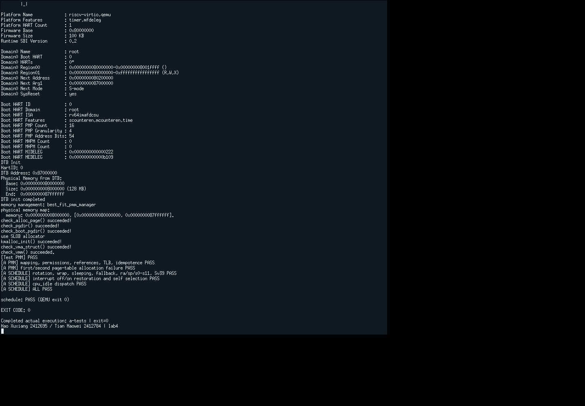
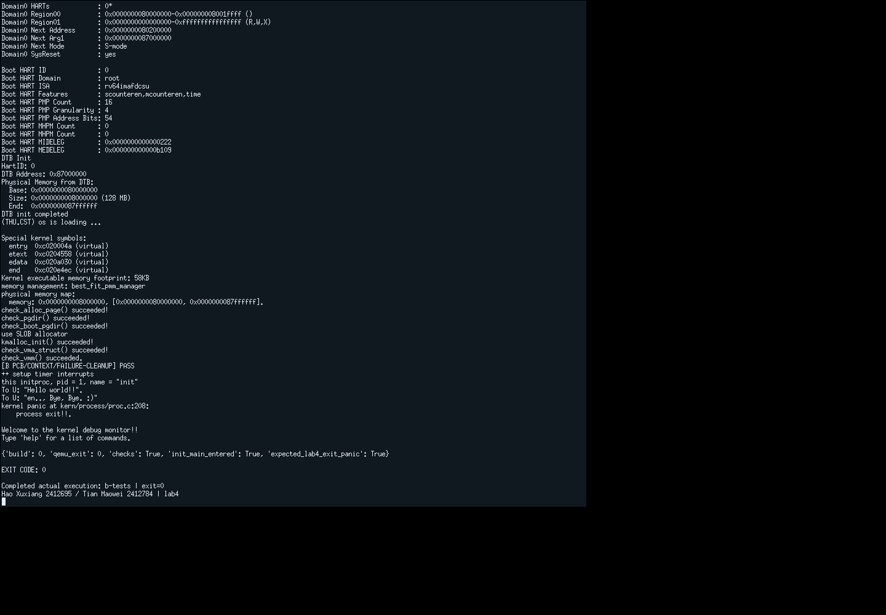
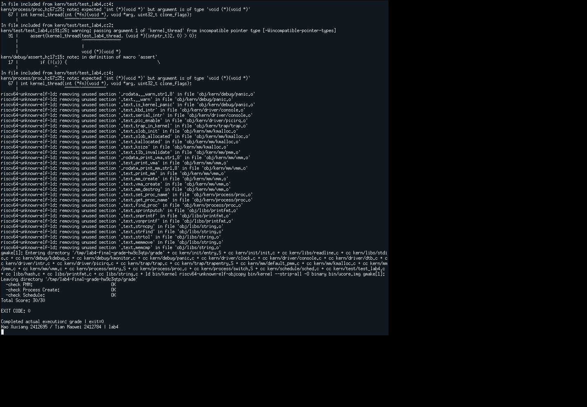

# Lab4 实验报告：页映射、线程创建与调度

## 一、小组信息与结果

| 成员 | 学号 | 分工 |
| --- | --- | --- |
| 郝煦享 | 2412695 | A：前置迁移、页映射、调度切换、专项测试与最终仓库整理 |
| 田茂炜 | 2412784 | B：PCB、创建初始化、失败清理、首次运行联调 |

整理日期：2026-11-23。最终提交分支：[lab4](https://github.com/KujoEnzo/OS2026/tree/lab4)。A/B 集成基线为 a9b0d53，本轮在其基础上补齐身份、文档、截图和最终复测，不更改功能算法。

完整构建、A 的 PMM/Schedule 回归、B 的 PCB/现场/失败清理检查通过；实际 initproc 执行成功，课程兼容评分 **30/30**。详见 [最终验收](final-validation.md)。

## 二、实验目的与执行路线

Lab2/3 提供物理页管理、页表基础和异常返回；Lab4 将这些资源组织为线程，再通过调度和寄存器切换执行线程函数。

```text
kern_init → pmm_init → pic_init/idt_init → vmm_init → proc_init
 → clock_init/intr_enable → cpu_idle → schedule → proc_run → switch_to
 → forkret → forkrets → __trapret → kernel_thread_entry → init_main
```

映射可用、PCB 存在和线程实际运行是三个不同阶段，实验需要将它们接通。

## 三、虚拟内存页操作（郝煦享，2412695）

Spec：page_insert 建立/更新映射，成功返回 0，分配失败返回 -E_NO_MEM；page_remove 对无映射地址幂等返回。要求页表、引用计数和 TLB 一致。

page_insert 先用 get_pte 定位叶 PTE，成功后先持有新页引用。同页重映射抵消多余引用、只更新权限，避免先减到零导致误释放；不同页替换撤销旧引用，最后写入新 PTE 并使对应 TLB 失效。

page_remove 先清 PTE 并使 TLB 失效，再减少引用，归零时释放数据页。无映射直接返回。数据页与中间页表生命周期不同；get_pte 第二级分配失败可能保留已有中间表供复用，不声称具有完整路径的事务回滚。

测试覆盖同页/不同页映射、权限、引用、实际访存的 TLB 一致性、幂等删除，以及两级页表分配失败。[A 技术分析](a-report.md) 保留详细设计。

## 四、线程创建与初始化（田茂炜，2412784）

| 函数 | Spec 与核心职责 |
| --- | --- |
| alloc_proc | 申请清零 PCB，UNINIT、PID=-1、物理页表根、独立链表节点 |
| proc_init | 初始化链表/哈希，包装启动现场为 idle，创建 pid1 的 initproc |
| kernel_thread | 临时 trapframe 的 s0/s1 保存函数/参数，epc 指向入口，调用 do_fork |
| do_fork | 申请 PCB/独立栈、检查地址空间、复制现场，最后发布 PID/链表/计数/状态 |
| copy_thread | 新栈顶复制帧，设置子线程 a0/sp/status 和 context.ra/sp |
| copy_mm | 本阶段只支持共享内核地址空间；父 mm 非空返回错误 |

idle 复用 bootstack 与当前执行现场，不进入普通进程链表。initproc 通过 kernel_thread 创建，拥有独立栈，父进程为 idle。pgdir 是物理地址。

新线程没有既往执行位置，必须构造 context.ra=forkret、context.sp=trapframe。经过 forkrets 和 sret 恢复后进入 kernel_thread_entry，将 s1 放到 a0，以 s0 调用线程函数。SPP=1、SPIE=1、SIE=0 配合首次 S-mode 恢复；context 和 trapframe 不能混用。

失败清理按申请逆序：PCB 失败直接返回；栈失败释放 PCB；地址空间失败先释放栈再释放 PCB。全部现场准备好后才在关中断区域挂接、计数并唤醒，避免半初始化对象被调度。

B 专项测试包含 PCB/栈失败、copy_mm 失败、进程上限、无效输入、显式子栈、父帧不变及资源/计数恢复。详细分析见 [B 报告](b-report.md)。

## 五、调度与上下文切换（郝煦享，2412695）

cpu_idle 根据 need_resched 调用 schedule。schedule 在中断保护下从当前线程之后循环选择 RUNNABLE，跳过哨兵和睡眠对象；允许唯一可运行的当前线程自选择，无普通线程时回退 idle。清除调用者标志并增加选中对象 runs。

proc_run 更新 current，用物理 pgdir 编码 Sv39 satp，执行全局 sfence.vma，再调用 switch_to。目标就是当前对象时不切换；恢复时还原调用前中断状态。

switch_to 只按 RV64 ABI 保存恢复 ra/sp/s0…s11，合计 14 个 8 字节字段，不参与调度策略。trapframe 则保存完整异常及首次返回现场。

A 测试使用人工 PCB、独立栈和逐线程不同的完整 64 位哨兵，验证轮转、回绕、睡眠跳过、自选择、回退、satp、寄存器和中断恢复、idle 派发。正式 initproc 路径另由 B 联调与课程评分验证。

## 六、Spec、Prompt 与真实问题

实现前的 spec 明确输入输出、状态变化、不变量、失败清理与验证方法，分别见 [A 阶段规格](a-spec.md) 与 [B 报告](b-report.md)。真实用户提示和任务上下文见 [prompt.md](prompt.md)；不把事后总结写成未发生的逐轮用户提示。

| 实际问题 | 解决方式 |
| --- | --- |
| 前置实验宏名与 Lab4 不同 | 从 memlayout 推导等价物理边界，保留容量和溢出检查 |
| loader 停留固件、入口为零 | 使用 -kernel 参数；不声称默认命令已通过 |
| satp 开启后物理 PC 取指故障 | 根表 index2 增加恒等映射，保留 index511 高地址映射 |
| 非叶 PTE 设置 U/A/D 不合法 | 中间表使用 ptd_create，修正一处非叶自检，保留叶权限与评分测试 |
| GCC14 类型诊断 | kva2page 显式地址转换；保留课程回调并降级相关诊断为 warning |
| 寄存器哨兵漏检高位截断 | 改用逐线程完整 64 位值，s11 的 ld→lw 反例失败，正常实现通过 |

原始失败与修复日志保留。四个独立评分文件 grade.sh、inject.py、test_lab4.c、test_lab4.h 与原课程包一致，但不能称所有框架自检完全未修改。

## 七、知识点与思考题

### 与 OS 原理的对应及差异

页表与 TLB 分别是内存中的翻译结构和处理器缓存，改前者后需要同步后者。引用计数管理映射持有关系，不能混淆数据页与中间页表。PCB 管理身份与资源，context 支撑线程切换，trapframe 支撑完整现场恢复。

当前链表选择不是完整的按时间片抢占公平调度；本地中断保护只面向单 hart，不等于多核锁。尚未完整实现用户地址空间复制、写时复制、换页、等待退出回收、系统调用、SMP 和跨核 TLB shootdown。

### 中断保护如何嵌套

local_intr_save 保存进入前 SIE 状态，必要时关闭；local_intr_restore 只在原先开启时再开启。所以 schedule 外层已关中断时，proc_run 内层不会擅自提前开启。恢复的是原状态，不是无条件开中断。

### Sv32、Sv39、Sv48 与 get_pte

Sv32 为两级、每级 10 位索引、4 字节 PTE；Sv39 三级、Sv48 四级，每级 9 位索引、8 字节 PTE，基础页为 4 KiB。get_pte 的相似代码分别查找/按需分配中间表，结构重复来自页表层级相同。

合并查找和分配可复用遍历，但调用者必须理解 create 的副作用及部分分配所有权。复杂系统可分离只读查找和创建接口，共用内部 walk；本实验保留原接口。

## 八、最终验证截图

以下是 WSL 私有虚拟显示中真实 Xterm 执行当前测试时的 framebuffer 抓屏，无损转换为 PNG，没有将旧日志重新排版伪装成运行截图。全部原始输出保存在 logs/final-lab4。

### A 页映射和调度回归



### B 创建与 initproc 执行



当前 do_exit 是课程 panic 占位。实际问候之后的 process exit!! 表示到达该边界，不表示退出回收已完成，也不能把其他 panic 当作正常。

### 课程兼容评分



评分保留课程回调类型 warning，不修改检查项与分值。截图中的英文成员拼写和学号是实际脚本打印的标识，中文署名以本报告为准。

## 九、验证边界

本轮完成源码复核和自动化测试，不代替成员声称未记录的人工作业检查。未新增真实时钟打断 schedule 扫描的压力测试；临界区覆盖经源码检查。A 相同映射的根表动态验证 satp，但不独立证明 proc_run 全局失效效果，该指令经源码/反汇编检查；局部页映射失效有实际访存测试。

旧 A 阶段文档、交接和失败日志保留历史价值，不代表当前仍缺 B。复现方式和所有结果见 [最终验收](final-validation.md)。
